<!--
  RaceOS — Portfolio Case Study (Contra / Upwork / personal site)
  Media placeholders look like:  📍 MEDIA 03b · <file path> · <what to do with it>
  Each placeholder is followed by a Markdown image link to the same file so the
  article previews correctly anywhere Markdown renders. Delete the 📍 lines once uploaded.
-->

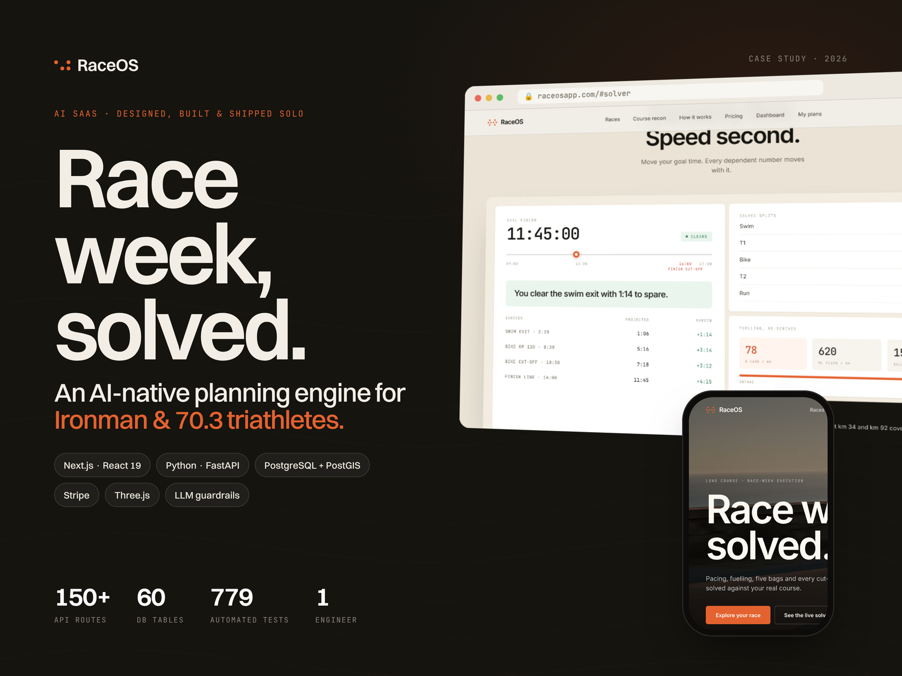

> 📍 **MEDIA 00 · COVER / THUMBNAIL** · `media/00_cover/raceos-cover_contra_1600x1200.png`
> Upload as the **project cover**. It is the thumbnail on your profile and in Contra Discover. For Upwork use `raceos-cover_upwork_1000x750.png`.

# RaceOS: An AI-Native SaaS for Ironman Race Planning, Designed, Engineered & Shipped Solo

### *Race week, solved.* A production SaaS that turns an athlete's fitness data and the real course into a complete race-day plan in seconds, with AI used only where it can be trusted.

**🔗 Live product:** [raceosapp.com](https://raceosapp.com/) · **💻 Source:** [github.com/roy-sub/raceos](https://github.com/roy-sub/raceos) · **🧑‍💻 Role:** Founder-engineer: product, design, AI, full-stack, DevOps

---

## ⚡ Project at a Glance

| | |
|---|---|
| **Product** | RaceOS, a B2C + B2B SaaS that generates race-execution plans for Ironman & 70.3 triathletes |
| **What it does** | Solves pacing, fuelling, cut-off margins and five transition-bag packing lists against the athlete's real course and forecast |
| **My role** | Sole designer, AI engineer, full-stack developer and DevOps, from concept to paying customers |
| **Stack** | Next.js 16 · React 19 · TypeScript · Three.js · Python · FastAPI · PostgreSQL + PostGIS · Supabase · Stripe · Render · Cloudflare Pages |
| **AI approach** | Deterministic solver for every number; LLM isolated behind a validation wall for language only |
| **Business model** | Free course recon → $19 per-race plan → $59/yr Season Pass → $99/mo Coach seat |
| **Status** | ✅ Live in production, payment-enabled |
| **Timeline** | `[ADD YOUR DATES, e.g. Aug – Oct 2026]` |

---

## 🏁 The Opportunity

An Ironman athlete trains for **6–12 months** and pays **$650–$850** for an entry. Then race day is decided by things that have nothing to do with fitness: a fuelling plan their gut can't handle, a cut-off they didn't see coming, a bag packed in a panic at 4 a.m.

> **"Nobody fails on fitness."** They fail on logistics, a fuelling number nobody checked, and a cut-off they never modelled.

Athletes were stitching plans together from **four or five disconnected tools**: pacing calculators, nutrition spreadsheets, paper checklists, weather apps and forum threads. And generic AI chatbots made it worse. A chatbot will happily recommend a carb intake that contradicts the bike split it suggested two paragraphs earlier.

📍 **MEDIA 02a** · `media/02_problem/02a_problem-nobody-fails-on-fitness.jpg` · The product's own problem statement, in a browser mockup.
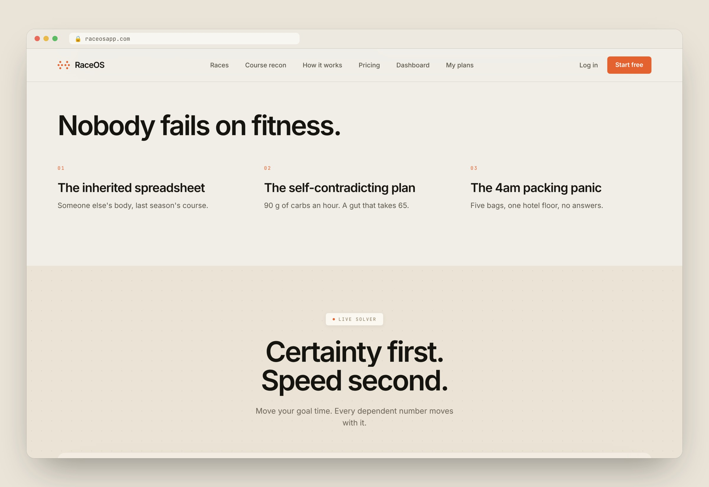

**The hardest unanswered question in triathlon communities** (*"what goes in my T2 bag vs. my special-needs bag?"*) had no intelligent answer in any product. Answering it means reasoning across pacing, nutrition **and** race-day weather at the same time.

---

## 💡 The Solution: One Engine, One Coherent Plan

RaceOS treats race execution as **one dependent planning problem**, not four separate calculators:

**Pacing → energy cost → fuelling needs → what physically goes in each bag**, recalculated against the real course and the live forecast.

📍 **MEDIA 02b** · `media/02_problem/02b_before-after-diagram.png` · Before/after diagram: 4 tools → 1 plan.
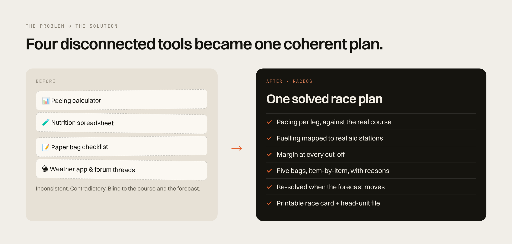

📍 **MEDIA 01a** · `media/01_hero/01a_hero-landing_desktop.jpg` · Landing page hero. Alternatively upload `01b_hero-brand-loop.mp4` (the site's own looping hero video).
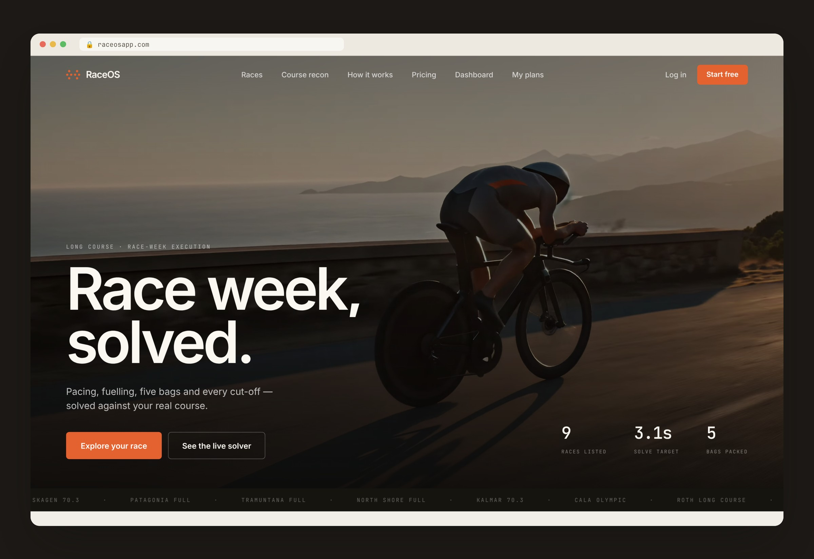

---

## 🧩 Core Features

📍 **MEDIA 03h (optional)** · `media/03_product/03h_feature-overview.jpg` · Feature overview section from the landing page.

### 1 · Interactive 3D Course Recon
Athletes explore their course **before they ride it**: a rotatable 3D terrain model with every aid station, cut-off and metre of climbing, plus a live readout that follows the cursor.

📍 **MEDIA 03a** · `media/03_product/03a_course-map-3d.jpg` · 3D course map (Three.js).
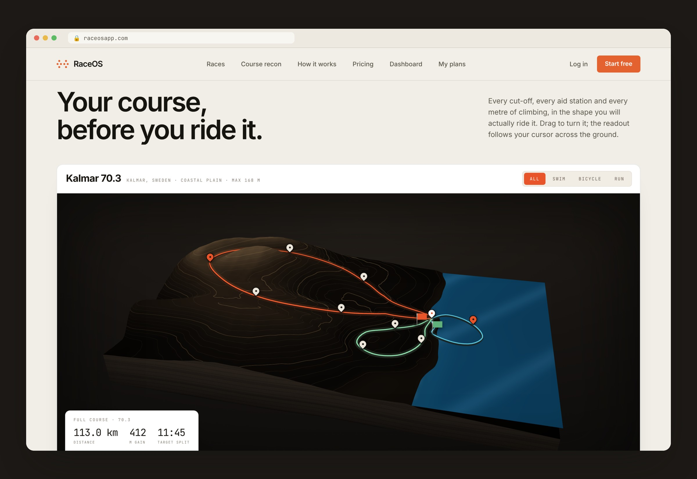

📍 **MEDIA 09b · VIDEO** · `media/09_video/09b_3d-course-map-demo.mp4` (GIF fallback: `.gif`) · Rotating the 3D course terrain with the live cursor readout.

### 2 · The Live Solver
Move the goal time and **every dependent number re-derives instantly**: splits, cut-off margins, carbs per hour, fluid, gels and bag contents.

📍 **MEDIA 03b** · `media/03_product/03b_live-solver.jpg`
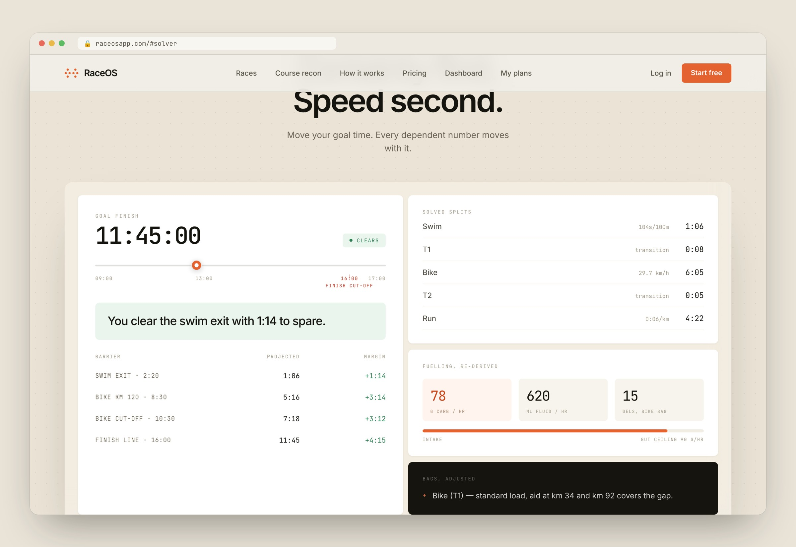

📍 **MEDIA 09a · VIDEO** · `media/09_video/09a_live-solver-demo.mp4` (GIF fallback: `.gif`) · Dragging the goal-time slider, then flipping through the five bags. **This is the strongest single asset; place it high on Contra.**

### 3 · Five Bags, No Guessing
Morning, T1, T2, Bike Special Needs, Run Special Needs, packed item by item. **Every item carries the reason it's there**, so athletes can disagree on Tuesday instead of at the aid station.

📍 **MEDIA 03c** · `media/03_product/03c_five-bags.jpg`
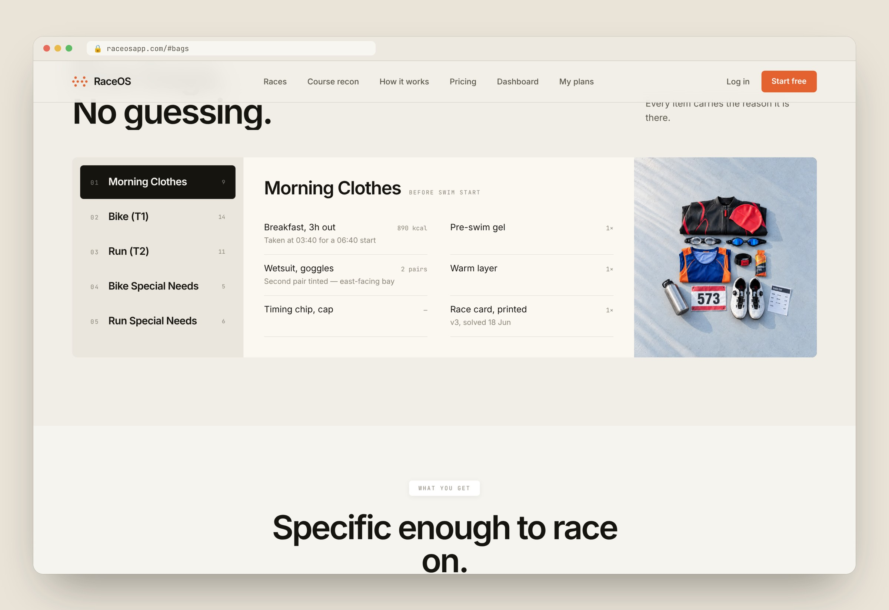

### 4 · Cut-Off Calculator & Course Intelligence (free funnel)
Per-leg elevation profiles parsed from GPX, every aid station with its supplies, and a **free, no-account cut-off calculator**. It's the product's top-of-funnel acquisition hook.

📍 **MEDIA 03d / 03e / 03f** · Upload as a 3-image gallery
`media/03_product/03d_course-recon.jpg` · `03e_elevation-profiles.jpg` · `03f_cutoff-calculator.jpg`
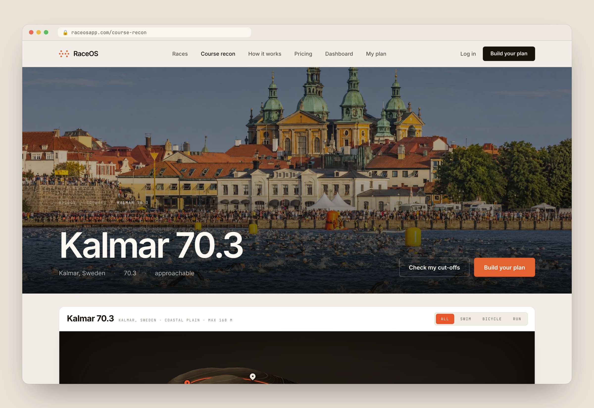
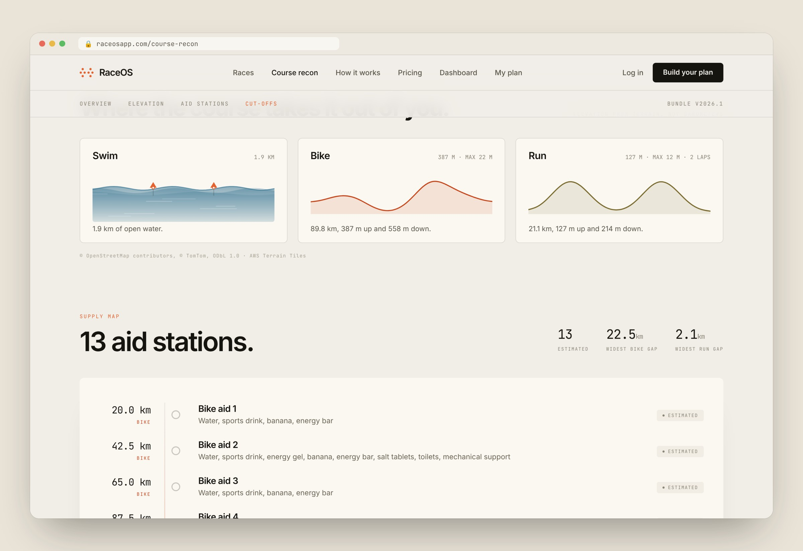
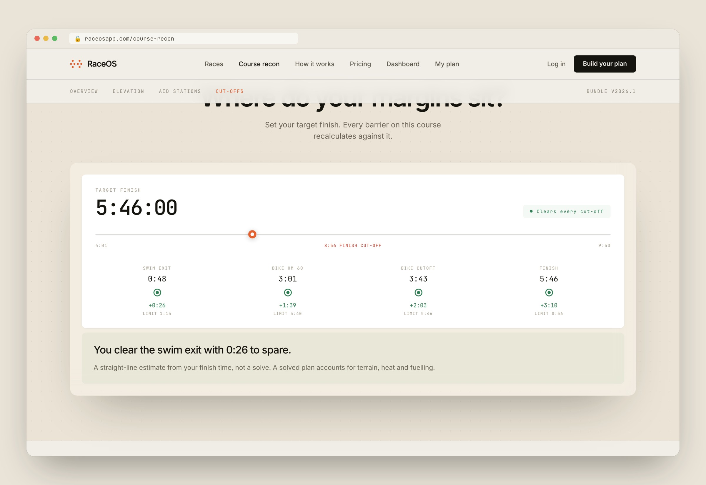

### 5 · Drift Detection: Nothing Changes Silently
When the race-week forecast moves, RaceOS **re-solves a shadow copy** and shows the athlete exactly what *would* change and what it costs. Their plan stays untouched until they approve.

### 6 · Race Card, Race Mode & Device Exports
A printable race card (PDF), an offline **Race Mode** for race morning, a `.FIT` course file for the athlete's bike computer, plus GPX and calendar (ICS) exports.

### 7 · Coach Workspace (B2B)
A coach seat manages **up to 15 athletes** with a race-week board, side-by-side comparison, **white-label exports** and permission-scoped sharing.

### 8 · SEO-Ready Race Directory
A searchable, filterable directory with a statically generated, **structured-data-rich page per race**, so organic search becomes a growth channel from day one.

📍 **MEDIA 03g** · `media/03_product/03g_race-directory.jpg`
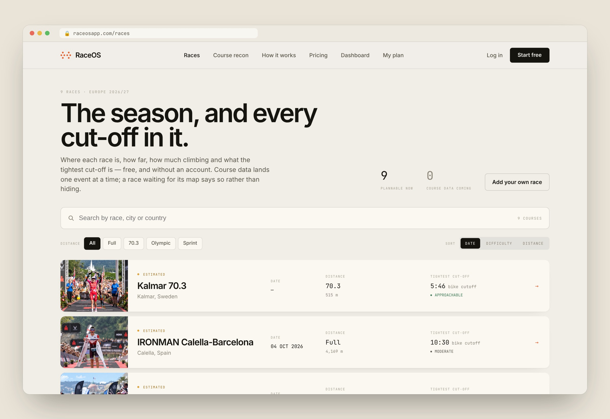

---

## 🤖 The AI Engineering: "A Solver, Not a Chatbot"

> **The design principle that defines this product:** *the solver decides, the model phrases.*

When someone will act on a number for 11 hours under physical stress, "the AI said so" isn't good enough. So I built RaceOS around a clear **trust boundary** between deterministic computation and generative AI.

📍 **MEDIA 04a** · `media/04_ai/04a_solver-not-chatbot.jpg`
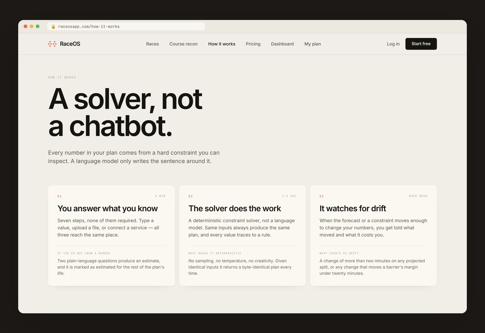

**How it works:**

- 🧮 **A deterministic six-stage solver produces every number.** It's built from published physics and sport-science models: cycling power-to-speed, heat (WBGT), altitude, air density and gut-tolerance limits. Same input → **byte-identical output**, every time.
- 🧱 **The LLM sits outside a validation wall.** It only receives already-correct text plus a whitelist of allowed terms, and rewrites it for readability.
- 🛡️ **A numeric-token validator checks every response.** If the model adds or alters *any* number, the rewrite is rejected and the deterministic text ships instead.
- 🧪 **An adversarial test proves it.** A deliberately "malicious" model is driven through every entry point, and the test asserts that no number it returns ever reaches an athlete.
- 🔌 **Model-agnostic and optional.** Works with any OpenAI-compatible endpoint behind one config flag. If the model fails, the product just gets a little less eloquent. It never gets less correct.

📍 **MEDIA 04b** · `media/04_ai/04b_ai-guardrail-diagram.png` · The AI trust-boundary diagram.
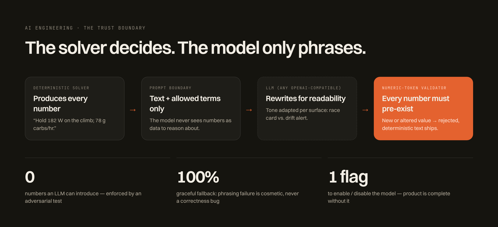

**Explainable by design.** Every number shows its **provenance** (measured, tested, typed or estimated), and the UI shows *which constraint is binding* and why.

📍 **MEDIA 04c / 04d / 04e** · Gallery: `04c_constraint-binds.jpg` · `04d_model-boundary.jpg` · `04e_provenance.jpg`
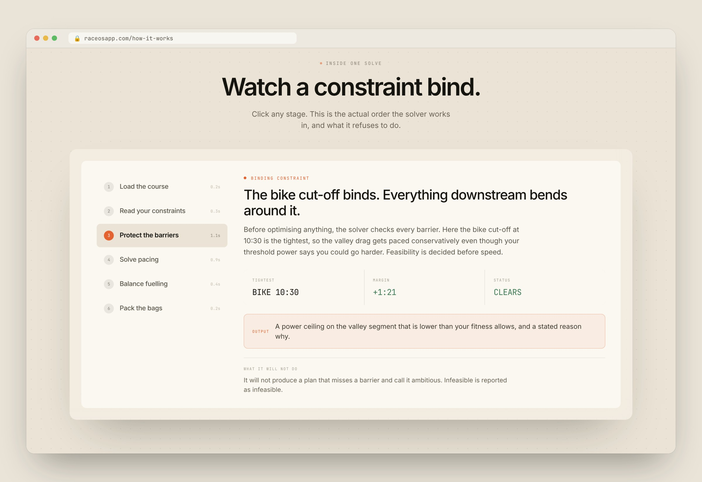
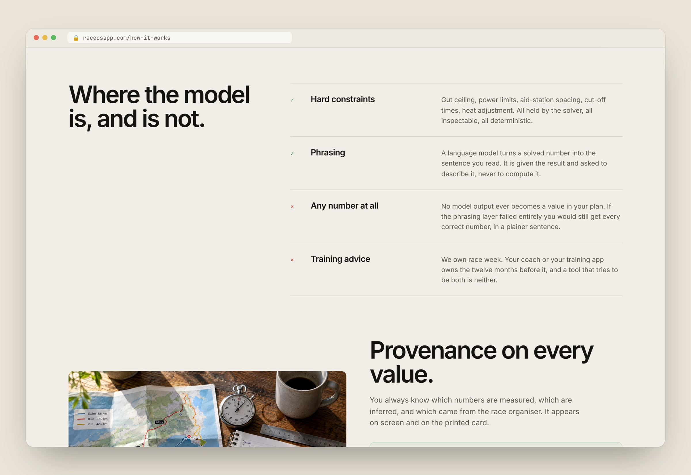
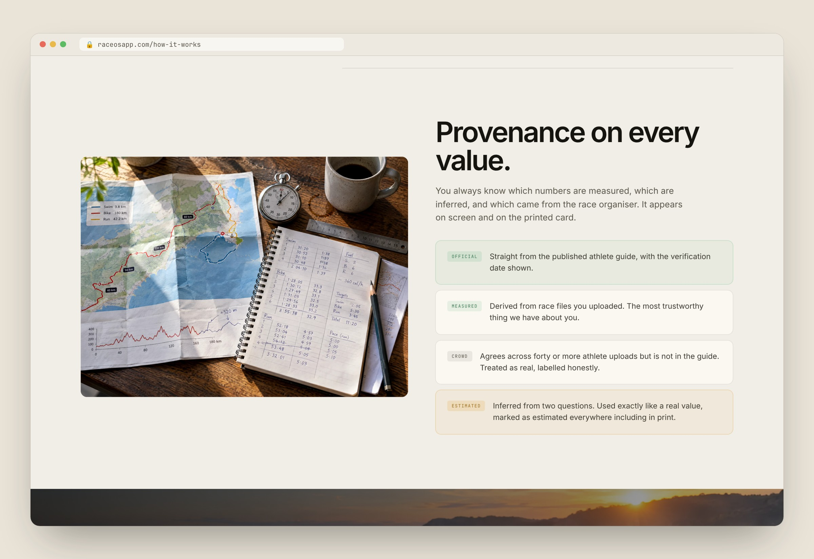

> 💬 **Why this matters for your project:** Most AI products fail on trust, not capability. I know when to use an LLM, when *not* to, and how to engineer guardrails so AI makes a product better without making it unreliable.

---

## 🏗️ Architecture & Engineering

📍 **MEDIA 05a** · `media/05_architecture/05a_system-architecture.png`
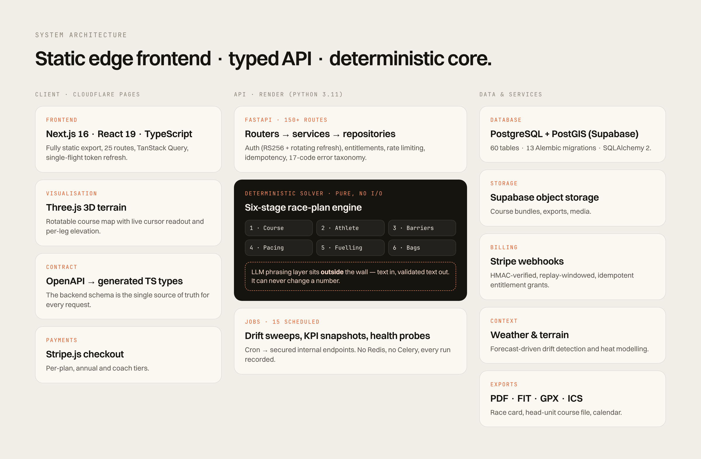

**Frontend:** Next.js 16 + React 19 + TypeScript as a **fully static export** on Cloudflare Pages. It has 25 routes, a typed API client generated from the backend's OpenAPI schema, TanStack Query, and Three.js for 3D terrain.

**Backend:** Python + FastAPI with **150+ routes across 19 domains**: auth, plans, drift, billing, coaching, sharing, exports, admin and ops. It's layered as routers → services → data, with a 17-code error taxonomy shared with the frontend.

**Data:** PostgreSQL + **PostGIS** on Supabase, with **60 tables**, 13 versioned Alembic migrations and GPX/geospatial ingest.

**Operations:** **15 scheduled jobs** (drift sweeps, KPI snapshots, health probes, renewal notices, data purges) run as secured internal endpoints with no Redis or Celery to maintain. Every run is recorded.

### The Six-Stage Solver Pipeline

📍 **MEDIA 05b** · `media/05_architecture/05b_solver-pipeline.png`
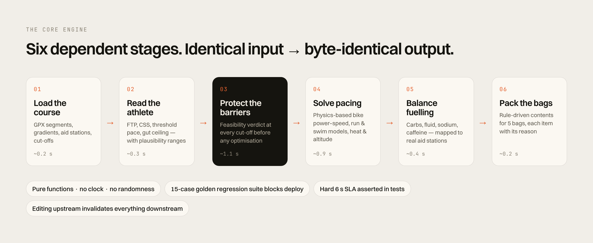

| Stage | What it solves |
|---|---|
| **1 · Course** | GPX segments, gradients, aid stations, cut-offs |
| **2 · Athlete** | FTP, swim CSS, run threshold, gut ceiling, with plausibility checks |
| **3 · Barriers** | A feasibility verdict at every cut-off, *before* any optimisation |
| **4 · Pacing** | Physics-based bike, run and swim models with heat and altitude |
| **5 · Fuelling** | Carbs, fluid, sodium and caffeine mapped to real aid stations |
| **6 · Bags** | Rule-driven contents for five bags, each with a stated reason |

Editing an upstream input **automatically invalidates everything downstream**, so an athlete never trusts a stale, self-contradicting plan on race morning.

### Engineering Decisions That Show Senior Judgement

| Decision | Why it matters to a client |
|---|---|
| Deterministic core, LLM at the edge | Reliable output you can audit, test and defend |
| Golden-file regression suite (15 scenarios) | A changed number **blocks deploy**, so there are no silent regressions |
| Performance budgets enforced in tests | 3.1 s solve target; a hard 6 s SLA fails the build |
| Payments by webhook, never client confirmation | No free-riding; idempotent and replay-safe |
| Security as architecture | RS256 JWTs, argon2id, refresh-token rotation with theft detection, HMAC-verified webhooks, rate limiting, redacted logs |
| Data access only via athlete-approved grants | Not even an admin screen is a back door, and tests prove it |
| Soft-delete plans; retire, never delete, courses | Financial and historical records always survive |
| Free-tier-first infrastructure | **≈ $0 fixed monthly cost**; costs scale only with usage |
| Every external service behind an interface | 779 tests run fully offline with zero credentials |

---

## 📊 By the Numbers

📍 **MEDIA 07a** · `media/07_kpis/07a_kpi-build-scope.png`
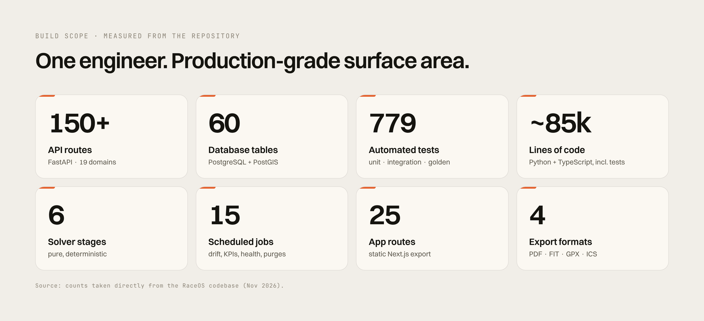

### Build Scope *(measured directly from the codebase)*

| Metric | Value |
|---|---|
| API routes | **150+** across 19 functional domains |
| Database tables | **60** (PostgreSQL + PostGIS) |
| Automated tests | **779** (unit, integration, golden-file, performance) |
| Codebase | **~85,000 lines** of Python + TypeScript (incl. tests) |
| Solver specification | **~2,900-line** technical model with worked examples |
| Scheduled background jobs | **15** |
| Frontend routes | **25** (static export) |
| Export formats | **4**: PDF · FIT · GPX · ICS |
| Engineers on the project | **1** |

📍 **MEDIA 07b** · `media/07_kpis/07b_kpi-product.png`
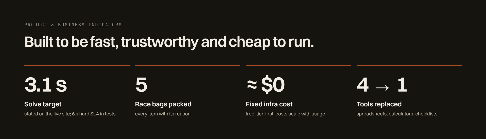

### Product & Business Indicators *(as stated by the live product)*

| Indicator | Value |
|---|---|
| Plan solve target | **3.1 seconds** |
| Athlete input time | **~6 minutes**, with every field optional |
| Fixed infrastructure cost | **≈ $0/month** (usage-proportional costs only) |
| Tools consolidated | **4–5 → 1** |
| Pricing tiers | **4**: Free · $19/race · $59/yr · $99/mo |

### Illustrative Unit Economics *(hypothetical scenario, not reported results)*

> ⚠️ *The figures below are a **modelled example** to show how the business model scales. They are not actual RaceOS revenue or user numbers.*

| Scenario | Illustrative outcome |
|---|---|
| 500 athletes buy one $19 Race Plan | ≈ $9,500 revenue on near-zero fixed infra |
| 200 Season Pass subscribers | ≈ $11,800 ARR |
| 20 coach seats | ≈ $23,760 ARR from the B2B tier |

`[OPTIONAL: Replace or supplement with verified figures you're comfortable sharing, e.g. plans solved, paying customers, conversion rate, Lighthouse score.]`

---

## 💳 Monetisation Built In

Four tiers, all wired to Stripe, with **entitlements served by the API** so the UI never hard-codes who can see what. The free recon and cut-off calculator draw athletes in; the $19 plan converts them.

📍 **MEDIA 06a / 06b** · Gallery: `media/06_monetisation/06a_pricing.jpg` · `06b_pricing-compare.jpg`
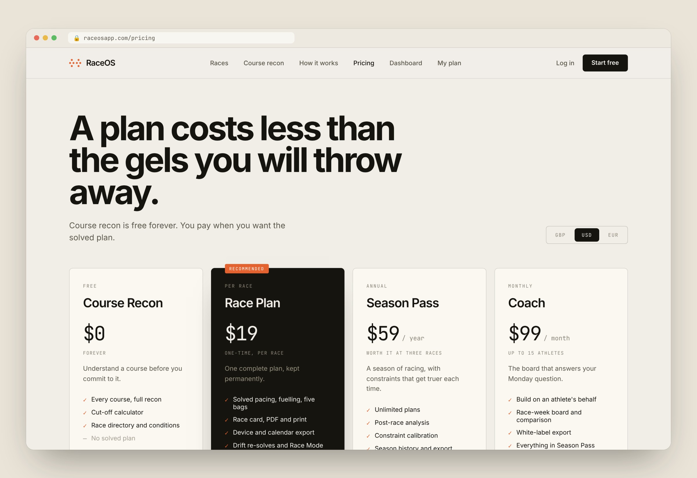
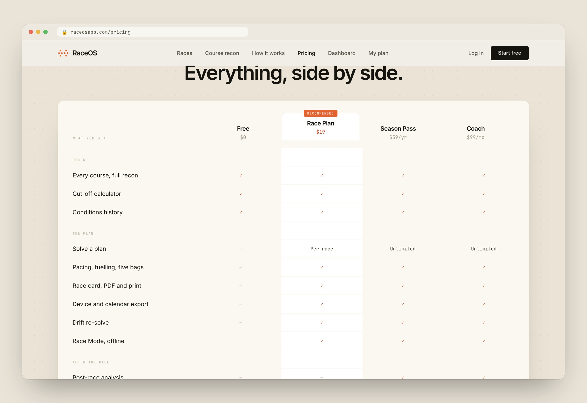

---

## 🎨 Design: Warm, Editorial, Race-Morning Calm

I designed RaceOS to feel **nothing like a fitness tracker**: a warm paper palette, one confident orange accent, editorial Switzer type and monospaced data. It's calm, credible and premium.

- Custom design-token system (paper, ink, accent, status colours)
- Art-directed race photography produced with a **generative-AI image pipeline**, briefed per race and cropped to banner and thumbnail ratios
- Mobile-first layouts for race morning; accessibility and Core Web Vitals treated as build requirements

📍 **MEDIA 08a** · `media/08_design/08a_design-system.png`
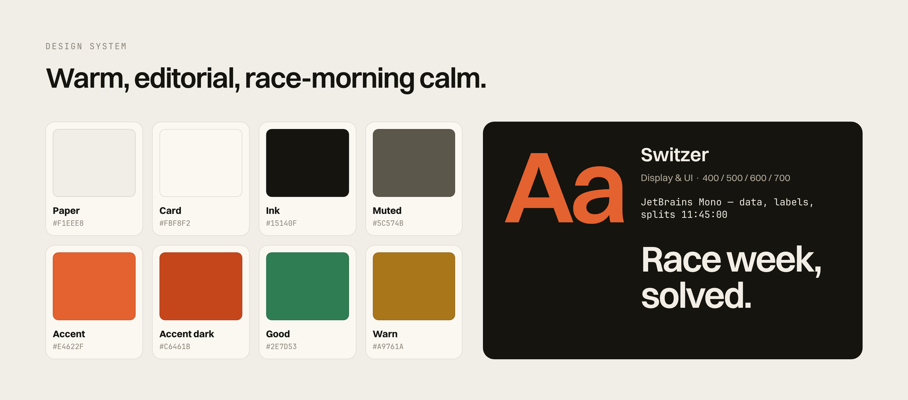

📍 **MEDIA 08b** · `media/08_design/08b_mobile-showcase.jpg`
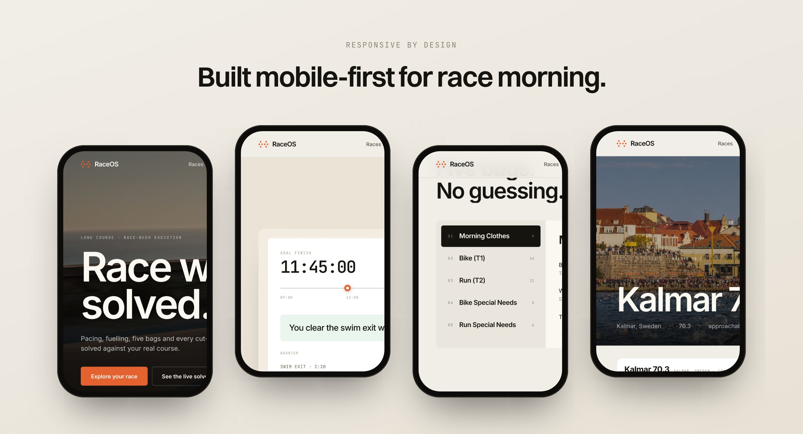

📍 **MEDIA 08c–08f (optional gallery)** · `08c_auth-flow.jpg` · `08d_brand-photo_bag-flatlay.jpg` · `08e_brand-photo_solver-desk.jpg` · `08f_brand-photo_dawn-swim.jpg`

---

## 🧑‍💻 My Role: One Developer, Every Layer

I owned RaceOS **end to end**: no agency, no team, no hand-offs.

📍 **MEDIA 10a** · `media/10_role/10a_capabilities.png`
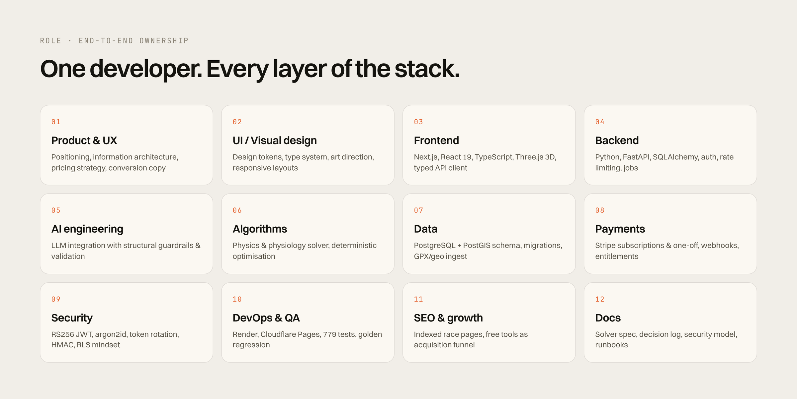

| Discipline | What I delivered |
|---|---|
| **Product strategy** | Problem framing, positioning, freemium funnel, four-tier pricing |
| **UI/UX design** | Information architecture, design system, art direction, responsive UI |
| **AI engineering** | LLM integration with structural guardrails, validation and graceful fallback |
| **Algorithm design** | Physics and physiology solver, deterministic optimisation, golden testing |
| **Frontend development** | Next.js, React, TypeScript, Three.js 3D, typed API client |
| **Backend development** | FastAPI, auth, entitlements, background jobs, exports, rate limiting |
| **Database architecture** | PostgreSQL + PostGIS schema, migrations, geospatial ingest |
| **Payments & integrations** | Stripe subscriptions + one-off purchases, webhooks, weather data, GPX ingest |
| **Security** | Token rotation, hashing, HMAC, permission-scoped sharing, security review |
| **DevOps & QA** | Render + Cloudflare Pages, 779 tests, golden-file deploy gate, build-time SEO checks |
| **Documentation** | Solver spec, decision log, security model, configuration & runbooks |

📍 **MEDIA 10b** · `media/10_role/10b_tech-stack.png`
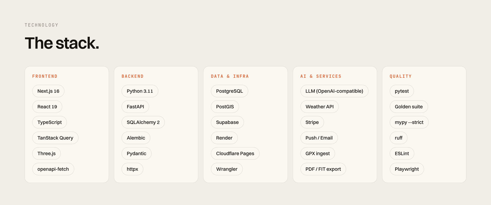

---

## 🏆 Results

- ✅ **Live in production** at [raceosapp.com](https://raceosapp.com/): deployed, payment-enabled, open to athletes
- ✅ **A genuinely new answer** to triathlon's most-asked logistics question (what goes in which bag), which no competing product addresses
- ✅ **Trustworthy AI by construction**: the language model *cannot* change a number, and tests prove it
- ✅ **Economically viable at small scale**: ≈ $0 fixed infrastructure cost
- ✅ **Built to be extended**: typed contracts, 779 tests, and documentation a new developer can pick up

`[OPTIONAL: Add a testimonial, athlete quote or launch metric here.]`

---

## 💬 What This Means for Your Project

If you're building a SaaS product, especially one with **AI at its core**, RaceOS shows what you get when you work with me:

- 🚀 **Idea to revenue, solo.** I take products from a blank page to a live, payment-enabled launch.
- 🧠 **AI that holds up.** LLMs, agents and automations engineered with validation, fallbacks and tests, not demos that break on contact with users.
- 🏗️ **Production-grade foundations.** Security, payments, background jobs, testing and documentation from day one.
- 🎨 **Design that sells.** Interfaces that look premium and convert, not developer-default UI.
- 📄 **Clean hand-over.** Typed, tested, documented code your team can own.

**Services I offer:** AI SaaS development · Custom SaaS MVPs · LLM & OpenAI/Claude API integration · AI agents & automations · Full-stack web apps (Next.js, React, Python, FastAPI) · Stripe & third-party integrations · UI/UX design for SaaS

📍 **MEDIA 11** · `media/11_cta/11_cta-work-with-me.png` · Closing card
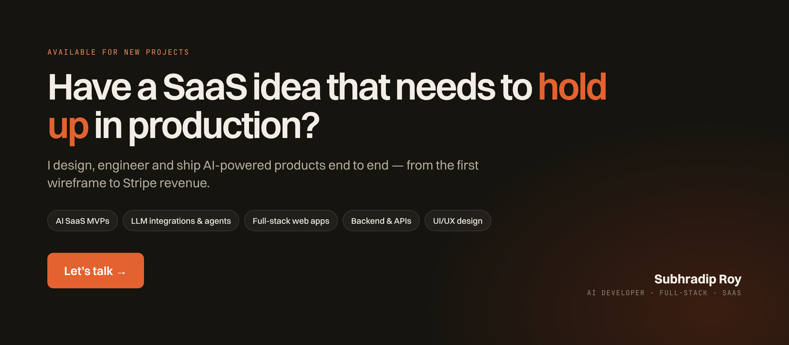

### 👉 Have a product that needs to *hold up* in production? **Send me a message** and let's talk about what you're building.

---

## ❓ FAQ

**What is RaceOS?**
RaceOS is an AI-native SaaS that generates complete race-execution plans (pacing, fuelling, cut-off margins and transition-bag packing lists) for Ironman and 70.3 triathletes, solved against the real course and forecast.

**Who built RaceOS?**
Subhradip Roy, an AI developer and full-stack SaaS engineer, designed, built and deployed RaceOS end to end as a solo project.

**What tech stack does RaceOS use?**
Next.js, React, TypeScript and Three.js on the frontend; Python, FastAPI, PostgreSQL + PostGIS and Supabase on the backend; Stripe for payments; Render and Cloudflare Pages for hosting; and an LLM layer behind a numeric validation wall.

**How does RaceOS use AI safely?**
A deterministic solver computes every number. A language model may only rephrase already-correct text, and any response that introduces or changes a number is automatically rejected.

**Can you build a similar AI SaaS for my business?**
Yes. I build custom AI SaaS products, LLM integrations and full-stack web apps end to end, from design through deployment and payments.

---

**Tags:** AI Engineer · AI Developer · Full-Stack Developer · SaaS Developer · Web Developer · UI/UX Designer · AI SaaS Development · Custom SaaS Development · LLM Integration · Next.js · React · TypeScript · Python · FastAPI · PostgreSQL · Supabase · Stripe · Three.js
